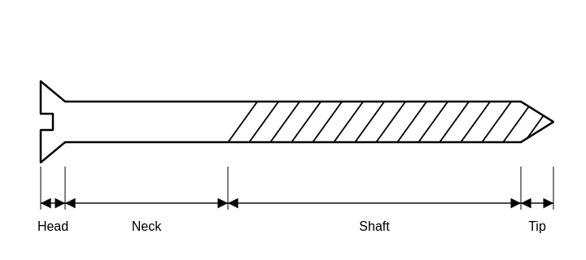
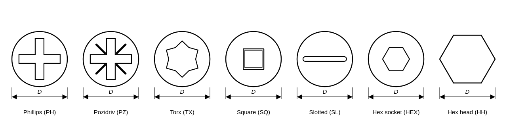
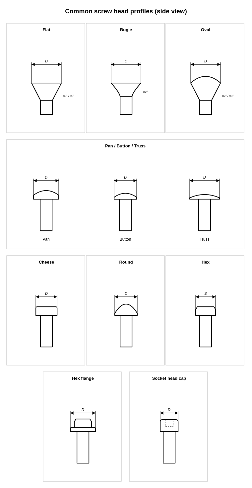
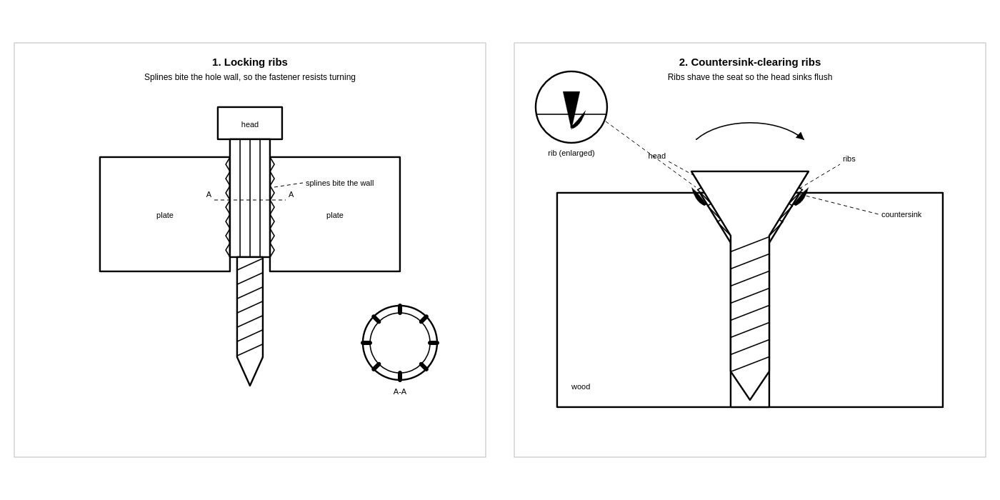

# Screws
## General
* Screws can be differentiated by 4 main properties; the head, the neck, the
  shaft, and the tip 
* The total "length" of the screw is measured from the tip to the widest part of
  the head
### Head
#### Slot
* The slot is the main interface between the driver and the screw.
* In Australia there are ~7 common head slot/interface types   
* Each one is "good enough", with the most important thing being using the
  correct size and shape bit-driver
* Most often the corresponding driver is denoted by the abbreviation and a
  number.
  The number indicates which size of that specific driver to use.
  (Eg.
  PH2 -> Philips head, size 2)
#### Profile
* The screw head can have a wide range of side-on profiles.
* All profiles are essentially a trade-off between clamp-area, protrusion, and
  allowing proper space for the driver 

| Head | Why it exists | How the shape does it |
|---|---|---|
| Flat (countersunk) | Sit flush with the surface. Removes protrusion where a raised head would snag, foul, or look wrong, and the conical seat self-centres and spreads load. | Cone underside mates a matching countersink. The seat converts axial clamp load into a wedging contact around the cone. Angle must match the hole: 82° inch, 90° metric. |
| Oval (raised CSK) | Flat-head seating with a domed top. The dome rounds the sharp edge that a flat head leaves, so it damages the workpiece or the operator less, and it looks finished. | Same cone as flat, plus a shallow spherical cap on top. Sits flush at the cone, protrudes slightly at the dome. |
| Bugle | Drive into gypsum board without tearing the paper face and without pre-drilling a countersink. The paper skin is what holds drywall together; a straight cone cuts it. | Concave (trumpet) underside rolls pressure outward and compresses the paper gradually instead of shearing it, so the head sinks flush cleanly. |
| Pan | The general-purpose machine-screw head. More bearing area than a countersunk head, no countersink needed, and a top that holds a drive recess without a sharp edge. | Flat underside for full bearing, rounded top, cylindrical sides. Chosen where head protrusion is acceptable. |
| Button | Low, smooth protrusion for socket-drive screws. Less obtrusive than pan but not sunk. Common on bicycle and furniture hardware. | Shallow dome, flat underside. Trades bearing area for a lower profile and a cleaner look. |
| Truss | Stop the head pulling through thin or soft material. Widens the bearing area so clamp load is spread and the sheet does not deform or tear out. | Wide, low, thin head with an undercut bearing surface, roughly 2.5d across. |
| Round (dome) | Smooth domed top that will not catch on anything and has no edge to cut. Larger dome than pan, so more bearing area. | Spherical cap on a flat underside. Older general-purpose head, still used where a rounded finish matters. |
| Cheese | Cylindrical head with a flat top. The flat top takes a clean slot and the tall cylinder gives the slot enough depth to carry torque without stripping. | Cylinder, height about half its diameter. Deep slot for drive torque. Common in European machine screws and electronics. |
| Fillister | Like cheese but taller and domed. The extra height allows a deeper slot, so more torque before the slot strips, and the tall head fills a counterbore. | Raised, domed top on a cylindrical body. Taller than cheese for more driving depth. |
| Hex | Allow high torque from a simple, robust external tool. Six flats give a positive drive that a spanner or socket surrounds fully, so it does not cam out. | Prismatic head dimensioned across flats (the spanner size). The tool encloses the head rather than engaging a recess. |
| Hex flange | Hex head plus a built-in washer face. Spreads bearing load without a separate washer, which saves a part and cannot be dropped or lost in assembly. | Hex body on an integral flange that widens the bearing contact at the same spanner size. |
| Socket head cap | Compact high-strength head. An internal hex socket lets a smaller head diameter carry the same torque as a bigger external hex, so it can sit in a counterbore and stay flush. | Cylindrical head, internal hex socket, tight tolerances, typically high strength class. Standard for machine tools, moulds, and precision assemblies. |
#### Ribs
* Modern screws can also have some sort of ribbing somewhere on the screw head.
* The purpose of the ribbing generally are to; help lock the screw in place once
  it is driven in, or help clear material to allow the screw to counter-sink its
  head (or some combination of the two). 

### Neck
#### Smooth
#### Ribbed
## Wood
## Metal

# References
